# AXR Icons

**126 original illustrations for developer stacks.**  Technology-inspired mascots with a consistent rounded-tile language.

[**Open the interactive gallery**](index.html) · [Assets and formats](assets/README.md) · [Integration guide](docs/INTEGRATION.md) · [Artwork notes](docs/ARTWORK.md)

> [!NOTE]
> This collection was imported from curated 126-icon PNG and SVG assets. The PNGs preserve the selected original artwork; `svg/vector/` contains editable but approximate vector traces. `svg/fidelity/` embeds PNG images and **is not real vector artwork**.

## At a glance

| 126 icons | 504 PNGs | 126 vector SVGs | 126 image-embedded SVGs |
|:--:|:--:|:--:|:--:|
| 13 categories | 16 / 32 / 64 / 256 px | Editable approximation | Raster-fidelity wrapper |

## All 126 icons — side by side

Every thumbnail below is the **actual 64px PNG asset in the repository**, not an invented mockup. Click an icon to download the 256px master.

| | | | | | |
|:--:|:--:|:--:|:--:|:--:|:--:|
| <a href="assets/png/256/001-linux.png"></a><br /><sub>Linux</sub> | <a href="assets/png/256/002-github.png"></a><br /><sub>GitHub</sub> | <a href="assets/png/256/003-python.png"></a><br /><sub>Python</sub> | <a href="assets/png/256/004-javascript.png"></a><br /><sub>JavaScript</sub> | <a href="assets/png/256/005-typescript.png"></a><br /><sub>TypeScript</sub> | <a href="assets/png/256/006-docker.png"></a><br /><sub>Docker</sub> |
| <a href="assets/png/256/007-kubernetes.png"></a><br /><sub>Kubernetes</sub> | <a href="assets/png/256/008-rust.png"></a><br /><sub>Rust</sub> | <a href="assets/png/256/009-html.png"></a><br /><sub>HTML</sub> | <a href="assets/png/256/010-css.png"></a><br /><sub>CSS</sub> | <a href="assets/png/256/011-git.png"></a><br /><sub>Git</sub> | <a href="assets/png/256/012-react.png"></a><br /><sub>React</sub> |
| <a href="assets/png/256/013-next-js.png"></a><br /><sub>Next.js</sub> | <a href="assets/png/256/014-node-js.png"></a><br /><sub>Node.js</sub> | <a href="assets/png/256/015-postgresql.png"></a><br /><sub>PostgreSQL</sub> | <a href="assets/png/256/016-mysql.png"></a><br /><sub>MySQL</sub> | <a href="assets/png/256/017-mongodb.png"></a><br /><sub>MongoDB</sub> | <a href="assets/png/256/018-redis.png"></a><br /><sub>Redis</sub> |
| <a href="assets/png/256/019-go.png">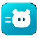</a><br /><sub>Go</sub> | <a href="assets/png/256/020-java.png"></a><br /><sub>Java</sub> | <a href="assets/png/256/021-c.png"></a><br /><sub>C</sub> | <a href="assets/png/256/022-cpp.png">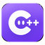</a><br /><sub>C++</sub> | <a href="assets/png/256/023-bash.png"></a><br /><sub>Bash</sub> | <a href="assets/png/256/024-arch-linux.png"></a><br /><sub>Arch Linux</sub> |
| <a href="assets/png/256/025-ubuntu.png"></a><br /><sub>Ubuntu</sub> | <a href="assets/png/256/026-debian.png"></a><br /><sub>Debian</sub> | <a href="assets/png/256/027-windows.png"></a><br /><sub>Windows</sub> | <a href="assets/png/256/028-macos.png"></a><br /><sub>macOS</sub> | <a href="assets/png/256/029-figma.png"></a><br /><sub>Figma</sub> | <a href="assets/png/256/030-tailwind-css.png"></a><br /><sub>Tailwind CSS</sub> |
| <a href="assets/png/256/031-vue-js.png"></a><br /><sub>Vue.js</sub> | <a href="assets/png/256/032-angular.png"></a><br /><sub>Angular</sub> | <a href="assets/png/256/033-svelte.png"></a><br /><sub>Svelte</sub> | <a href="assets/png/256/034-vite.png"></a><br /><sub>Vite</sub> | <a href="assets/png/256/035-php.png"></a><br /><sub>PHP</sub> | <a href="assets/png/256/036-csharp.png">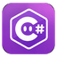</a><br /><sub>C#</sub> |
| <a href="assets/png/256/037-sqlite.png"></a><br /><sub>SQLite</sub> | <a href="assets/png/256/038-aws.png"></a><br /><sub>AWS</sub> | <a href="assets/png/256/039-astro.png"></a><br /><sub>Astro</sub> | <a href="assets/png/256/040-nuxt.png">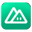</a><br /><sub>Nuxt</sub> | <a href="assets/png/256/041-sveltekit.png"></a><br /><sub>SvelteKit</sub> | <a href="assets/png/256/042-solidjs.png"></a><br /><sub>SolidJS</sub> |
| <a href="assets/png/256/043-htmx.png"></a><br /><sub>HTMX</sub> | <a href="assets/png/256/044-webpack.png">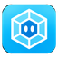</a><br /><sub>Webpack</sub> | <a href="assets/png/256/045-preact.png"></a><br /><sub>Preact</sub> | <a href="assets/png/256/046-alpine-js.png">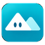</a><br /><sub>Alpine.js</sub> | <a href="assets/png/256/047-express-js.png"></a><br /><sub>Express.js</sub> | <a href="assets/png/256/048-nestjs.png"></a><br /><sub>NestJS</sub> |
| <a href="assets/png/256/049-fastapi.png"></a><br /><sub>FastAPI</sub> | <a href="assets/png/256/050-django.png"></a><br /><sub>Django</sub> | <a href="assets/png/256/051-flask.png"></a><br /><sub>Flask</sub> | <a href="assets/png/256/052-laravel.png">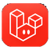</a><br /><sub>Laravel</sub> | <a href="assets/png/256/053-spring-boot.png"></a><br /><sub>Spring Boot</sub> | <a href="assets/png/256/054-aspdotnet-core.png"></a><br /><sub>ASP.NET Core</sub> |
| <a href="assets/png/256/055-kotlin.png"></a><br /><sub>Kotlin</sub> | <a href="assets/png/256/056-swift.png"></a><br /><sub>Swift</sub> | <a href="assets/png/256/057-dart.png"></a><br /><sub>Dart</sub> | <a href="assets/png/256/058-ruby.png"></a><br /><sub>Ruby</sub> | <a href="assets/png/256/059-lua.png"></a><br /><sub>Lua</sub> | <a href="assets/png/256/060-zig.png"></a><br /><sub>Zig</sub> |
| <a href="assets/png/256/061-scala.png"></a><br /><sub>Scala</sub> | <a href="assets/png/256/062-elixir.png"></a><br /><sub>Elixir</sub> | <a href="assets/png/256/063-mariadb.png"></a><br /><sub>MariaDB</sub> | <a href="assets/png/256/064-sql-server.png"></a><br /><sub>SQL Server</sub> | <a href="assets/png/256/065-oracle-database.png"></a><br /><sub>Oracle Database</sub> | <a href="assets/png/256/066-supabase.png"></a><br /><sub>Supabase</sub> |
| <a href="assets/png/256/067-firebase.png"></a><br /><sub>Firebase</sub> | <a href="assets/png/256/068-elasticsearch.png"></a><br /><sub>Elasticsearch</sub> | <a href="assets/png/256/069-clickhouse.png"></a><br /><sub>ClickHouse</sub> | <a href="assets/png/256/070-dynamodb.png"></a><br /><sub>DynamoDB</sub> | <a href="assets/png/256/071-azure.png"></a><br /><sub>Azure</sub> | <a href="assets/png/256/072-google-cloud.png"></a><br /><sub>Google Cloud</sub> |
| <a href="assets/png/256/073-cloudflare.png"></a><br /><sub>Cloudflare</sub> | <a href="assets/png/256/074-vercel.png">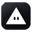</a><br /><sub>Vercel</sub> | <a href="assets/png/256/075-netlify.png"></a><br /><sub>Netlify</sub> | <a href="assets/png/256/076-nginx.png"></a><br /><sub>Nginx</sub> | <a href="assets/png/256/077-apache.png"></a><br /><sub>Apache</sub> | <a href="assets/png/256/078-digitalocean.png"></a><br /><sub>DigitalOcean</sub> |
| <a href="assets/png/256/079-terraform.png">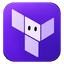</a><br /><sub>Terraform</sub> | <a href="assets/png/256/080-opentofu.png"></a><br /><sub>OpenTofu</sub> | <a href="assets/png/256/081-ansible.png"></a><br /><sub>Ansible</sub> | <a href="assets/png/256/082-jenkins.png"></a><br /><sub>Jenkins</sub> | <a href="assets/png/256/083-github-actions.png"></a><br /><sub>GitHub Actions</sub> | <a href="assets/png/256/084-gitlab.png">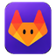</a><br /><sub>GitLab</sub> |
| <a href="assets/png/256/085-helm.png"></a><br /><sub>Helm</sub> | <a href="assets/png/256/086-argo-cd.png"></a><br /><sub>Argo CD</sub> | <a href="assets/png/256/087-prometheus.png"></a><br /><sub>Prometheus</sub> | <a href="assets/png/256/088-grafana.png"></a><br /><sub>Grafana</sub> | <a href="assets/png/256/089-opentelemetry.png"></a><br /><sub>OpenTelemetry</sub> | <a href="assets/png/256/090-sentry.png"></a><br /><sub>Sentry</sub> |
| <a href="assets/png/256/091-zabbix.png"></a><br /><sub>Zabbix</sub> | <a href="assets/png/256/092-grafana-loki.png"></a><br /><sub>Grafana Loki</sub> | <a href="assets/png/256/093-datadog.png"></a><br /><sub>Datadog</sub> | <a href="assets/png/256/094-jaeger.png"></a><br /><sub>Jaeger</sub> | <a href="assets/png/256/095-tauri.png"></a><br /><sub>Tauri</sub> | <a href="assets/png/256/096-electron.png"></a><br /><sub>Electron</sub> |
| <a href="assets/png/256/097-flutter.png"></a><br /><sub>Flutter</sub> | <a href="assets/png/256/098-react-native.png"></a><br /><sub>React Native</sub> | <a href="assets/png/256/099-android.png"></a><br /><sub>Android</sub> | <a href="assets/png/256/100-ios.png"></a><br /><sub>iOS</sub> | <a href="assets/png/256/101-qt.png"></a><br /><sub>Qt</sub> | <a href="assets/png/256/102-dotnet.png"></a><br /><sub>.NET</sub> |
| <a href="assets/png/256/103-pytorch.png"></a><br /><sub>PyTorch</sub> | <a href="assets/png/256/104-tensorflow.png"></a><br /><sub>TensorFlow</sub> | <a href="assets/png/256/105-hugging-face.png"></a><br /><sub>Hugging Face</sub> | <a href="assets/png/256/106-openai.png"></a><br /><sub>OpenAI</sub> | <a href="assets/png/256/107-ollama.png"></a><br /><sub>Ollama</sub> | <a href="assets/png/256/108-langchain.png"></a><br /><sub>LangChain</sub> |
| <a href="assets/png/256/109-jupyter.png"></a><br /><sub>Jupyter</sub> | <a href="assets/png/256/110-scikit-learn.png"></a><br /><sub>Scikit-learn</sub> | <a href="assets/png/256/111-vs-code.png"></a><br /><sub>VS Code</sub> | <a href="assets/png/256/112-visual-studio.png"></a><br /><sub>Visual Studio</sub> | <a href="assets/png/256/113-intellij-idea.png"></a><br /><sub>IntelliJ IDEA</sub> | <a href="assets/png/256/114-neovim.png">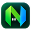</a><br /><sub>Neovim</sub> |
| <a href="assets/png/256/115-postman.png"></a><br /><sub>Postman</sub> | <a href="assets/png/256/116-playwright.png"></a><br /><sub>Playwright</sub> | <a href="assets/png/256/117-vitest.png"></a><br /><sub>Vitest</sub> | <a href="assets/png/256/118-jest.png">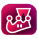</a><br /><sub>Jest</sub> | <a href="assets/png/256/119-fedora.png"></a><br /><sub>Fedora</sub> | <a href="assets/png/256/120-opensuse.png"></a><br /><sub>openSUSE</sub> |
| <a href="assets/png/256/121-kali-linux.png"></a><br /><sub>Kali Linux</sub> | <a href="assets/png/256/122-linux-mint.png"></a><br /><sub>Linux Mint</sub> | <a href="assets/png/256/123-unity.png">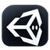</a><br /><sub>Unity</sub> | <a href="assets/png/256/124-unreal-engine.png"></a><br /><sub>Unreal Engine</sub> | <a href="assets/png/256/125-godot.png"></a><br /><sub>Godot</sub> | <a href="assets/png/256/126-blender.png"></a><br /><sub>Blender</sub> |

> Preview PNGs are intentionally used because the auto-traced SVG paths do not reproduce every illustration detail.

## Formats

| Format | Use | Limitation |
|:--|:--|:--|
| [PNG 16 / 32 / 64 / 256](assets/png/64/) | UI, profile cards, web, README, stacks | Raster; choose the proper size |
| [SVG paths](assets/svg/vector/) | Editing contours or experimenting with recoloring | Automated approximation; check small details |
| [SVG image wrappers](assets/svg/fidelity/) | Tools that require an SVG container with identical raster look | Contains base64 PNG; not a scalable vector |

## Integration

Use the machine-readable [registry.json](registry.json) and the stack-name resolver in [src/resolve.mjs](src/resolve.mjs). Multiple spellings such as `nextjs`, `C++`, `c#`, `k8s`, `vscode` and `gcp` resolve to canonical slugs. Unknown stacks return `null`, so consumers can show a fallback.

```js
import registry from './registry.json' with { type: 'json' };
import { buildStackIndex, resolveIcon } from './src/resolve.mjs';

const index = buildStackIndex(registry);
const icon = resolveIcon(index, 'Next.js', { format: 'png', size: 64 });
```

In a browser, the provided static gallery uses `fetch('./registry.json')`. Start a local server from the repo root with `python -m http.server 8000` and open [http://localhost:8000](http://localhost:8000).

## Validation

```bash
python -m pip install 'Pillow>=10,<13'
python scripts/validate.py
node scripts/test_resolver.mjs
```

The validator checks 126 distinct records, all 756 icon-format files, 757 media-file SHA-256 hashes, real SVG path presence, correct image dimensions, alpha corners and README thumbnails. Automated checks do not certify artistic quality.

## Adding technologies

Produce artwork in [batches of six](docs/BATCH-WORKFLOW.md) and keep image generation separate from vector tracing. Review size, contrast, and shape before the new artwork becomes part of the production registry.

## Rights

See [NOTICE.md](NOTICE.md). No public license has been selected yet; technology names may be third-party trademarks. No affiliation or endorsement is implied.
